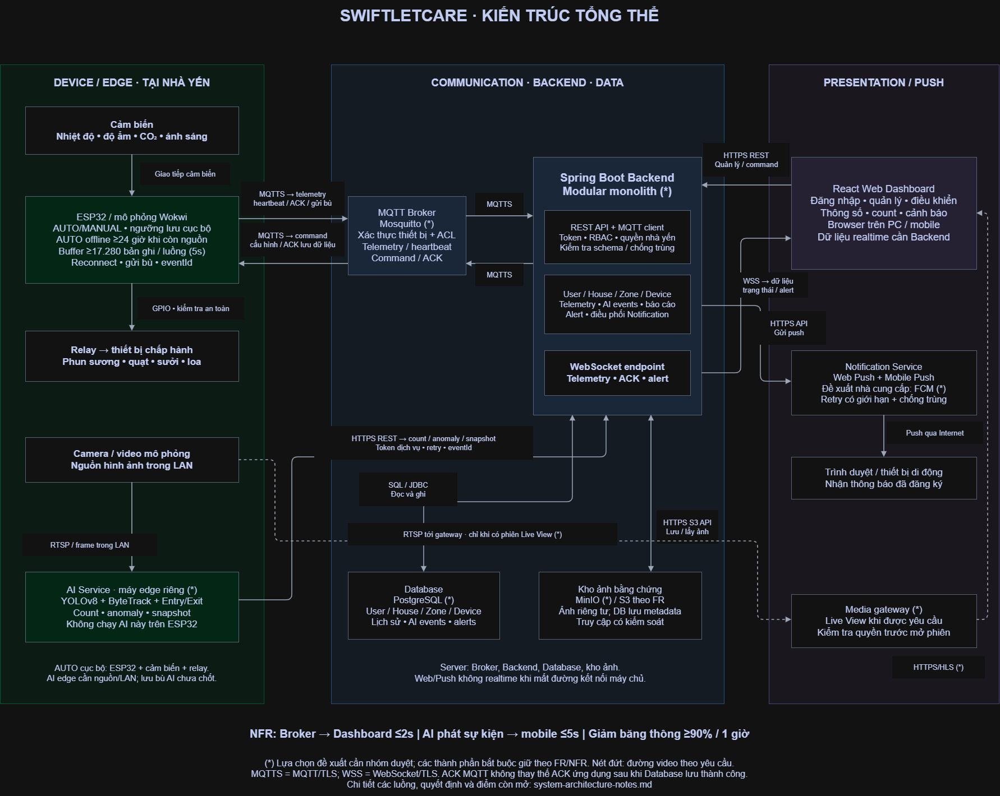

# SwiftletCare — System Architecture

> **Loại tài liệu:** Kiến trúc tổng thể hệ thống  
> **Phiên bản:** 1.0 — 18/10/2026  
> **Phạm vi:** Mô tả thành phần, ranh giới hệ thống, giao thức, luồng tích hợp và các quyết định kỹ thuật.  
> **Cơ sở:** `system-architecture.png` cùng kiến trúc IoT, AI, Backend, Class Diagram, ERD và hợp đồng MQTT/REST đã xây dựng.  
> **Lưu ý:** Nội dung có ký hiệu `(*)`, `PROPOSED` hoặc `OPEN` là thiết kế dự kiến, chưa xác nhận đã triển khai.

## 1. Giới thiệu

**SwiftletCare** là hệ thống giám sát và điều khiển môi trường nhà yến, kết hợp thiết bị IoT, phân tích video bằng AI, Backend Java Spring Boot và Dashboard React. Kiến trúc phân thành ba vùng:

1. **Device / Edge:** cảm biến, ESP32 hoặc Wokwi, relay/thiết bị chấp hành, camera và AI Service riêng.
2. **Communication / Backend / Data:** MQTT Broker, Spring Boot, Database và kho lưu ảnh bằng chứng (nếu sử dụng).
3. **Presentation / Push:** React Dashboard, WebSocket, dịch vụ thông báo và Media Gateway tùy chọn.

## 2. Danh mục tài liệu

| File | Nội dung kiến trúc |
|---|---|
| `system-architecture.png` | Sơ đồ các vùng, thành phần và kênh kết nối |
| `system-architecture.drawio` | Nguồn sơ đồ chỉnh sửa được, nếu có bản gốc |
| `architecture-overview.md` | Cấu trúc, chức năng và ranh giới các thành phần |
| `integration-flows.md` | Tám luồng tích hợp chính và tình huống lỗi |
| `architecture-decisions.md` | Công nghệ, ràng buộc, lựa chọn chưa chốt |
| `review-checklist.md` | Danh sách kiểm tra tính đúng đắn và nhất quán của kiến trúc |

**Ghi chú nguồn:** Bộ này có ảnh PNG, không có tệp Draw.io gốc. File `.drawio` chỉ nên đưa vào thư mục khi có đúng nguồn chỉnh sửa được; không đổi đuôi ảnh thành `.drawio`.

## 3. Nguyên tắc kiến trúc

- **Phân tách trách nhiệm kỹ thuật:** ESP32 đọc cảm biến/điều khiển cục bộ; MQTT Broker chuyển bản tin; Spring Boot xử lý nghiệp vụ và dữ liệu; AI Service phân tích hình ảnh; React hiển thị và gửi yêu cầu.
- **Luồng IoT:** Telemetry và Heartbeat đi qua MQTT, không ghi trực tiếp từ trình duyệt vào Database.
- **Luồng Web:** REST API để truy vấn/thao tác, WebSocket để cập nhật thời gian thực.
- **Luồng AI:** Camera/video truyền cho AI Service độc lập; kết quả phân tích được gửi đến Spring Boot qua HTTP nội bộ.
- **Dữ liệu bền vững:** Database lưu Entity và lịch sử; ảnh bằng chứng có thể lưu ở kho đối tượng riêng.
- **Điều khiển ngoại tuyến:** AUTO vẫn có thể chạy cục bộ khi mất kết nối nếu cảm biến, actuator và cấu hình an toàn.

## 4. Các giá trị giao tiếp đã thống nhất

| Thành phần / Quy tắc | Giá trị thiết kế |
|---|---|
| Telemetry identity | MQTT `event_id`, Java `eventId`, SQL `event_id` |
| Telemetry interval | Mặc định 5 giây, cấu hình 1–60 giây |
| Heartbeat | 2 giây/lần |
| Offline timeout | 6 giây; Backend kiểm tra mỗi 1 giây |
| Telemetry ACK | Application ACK `STORED` sau khi dữ liệu đã được lưu hợp lệ |
| Control actions | `SET_MODE`, `SET_STATE` |
| Control modes | `AUTO`, `MANUAL`, tách biệt trạng thái ONLINE/OFFLINE |
| Sensor status | `OK`, `PARTIAL_ERROR`, `ERROR` |

Các giá trị này là **cấu hình/yêu cầu thiết kế**, không mặc nhiên xác nhận đã đạt hiệu năng thực tế.

## 5. Phạm vi và giới hạn

Kiến trúc mô tả cấu trúc logic và đường đi của dữ liệu; không phải bản vẽ đấu nối chân GPIO, sơ đồ triển khai vật lý chi tiết hay kết quả kiểm thử NFR.

Các giải pháp có dấu `(*)` trên sơ đồ — ví dụ Mosquitto, PostgreSQL, MinIO/S3, FCM và Media Gateway — cần được phân biệt với các thành phần đã xác nhận trong `architecture-decisions.md`.

## 6. Tài liệu kiến trúc liên quan

- `../iot/`: kiến trúc firmware, cảm biến, điều khiển, offline/recovery.
- [MQTT contract MVP](../../mqtt/topics.md): Topic, Payload, ACK, QoS; Retain/LWT ngoài phạm vi được ghi rõ.
- `../backend/`: cấu trúc Spring Boot, security, MQTT ingestion.
- [Class Diagram](../class/class-diagram-overview.md): các Entity và quan hệ đối tượng.
- [ERD](../erd/README.md), [mapping MVP](../erd/build104-mvp-mapping.md): database triển khai và thiết kế tổng thể.
- [API](../../api/README.md), [contract MVP](../../api/build104-mvp.md): OpenAPI, DTO và WebSocket.

Các đường dẫn này là vị trí tham chiếu dự kiến theo cấu trúc repository; chỉnh lại nếu thư mục thực tế khác.
